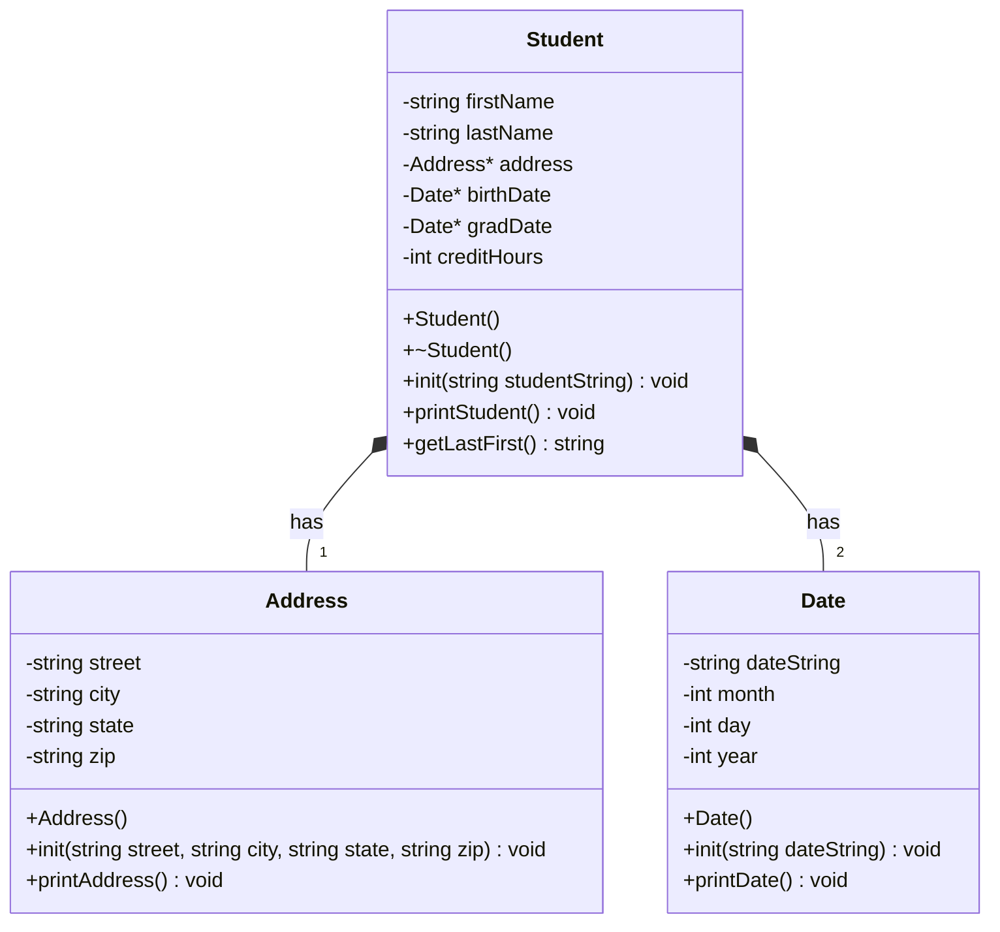

# Student Database Part 1

## Progress

This week I designed the UML for the whole project and made header files for Address, Date, and Student. Address and Date are implemented and tested. I also finished the Student class early, so the full test in main.cpp runs and matches the expected output. I ran it through valgrind and there are no memory leaks.

## UML

Student owns one Address and two Dates. I kept zip as a string since zip codes can start with 0.

## Algorithms

Date init
1. save the date string
2. put the string in a stringstream
3. read up to the first / into month string
4. read up to the next / into day string
5. read the rest into year string
6. convert all three to ints with stoi

Date print
1. make an array of the 12 month names
2. if month is not between 1 and 12, print invalid date and stop
3. print months[month - 1], then day, a comma, and year

Address print
1. print street on the first line
2. print city, state, a comma, then zip on the second line

Student constructor
1. set names to empty and credits to 0
2. create a new Address and two new Dates

Student destructor
1. delete the address and both dates

Student init
1. put the CSV line in a stringstream
2. read each field up to a comma: first name, last name, street, city, state, zip, birth date, grad date
3. read the rest of the line as credits
4. pass street, city, state, zip to address init
5. pass the birth date string to birthDate init
6. pass the grad date string to gradDate init
7. convert credits to an int with stoi

Student print
1. print first and last name
2. print the address
3. print "DOB: " and the birth date
4. print "Grad: " and the grad date
5. print the credits
6. print a line of underscores

getLastFirst
1. return last name, a comma, and first name

## Extra

- Finished the Student class this week instead of just the header
- Date print checks for a bad month so it doesn't go past the end of the array
- Checked for memory leaks with valgrind (make valgrind)
